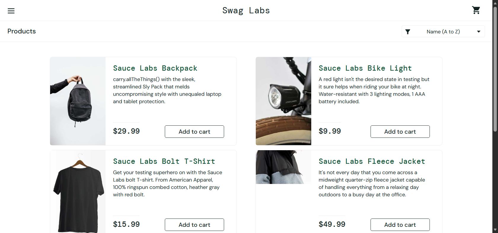
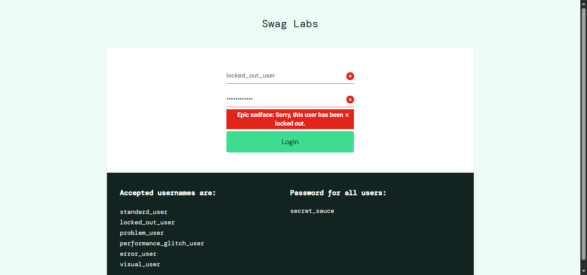
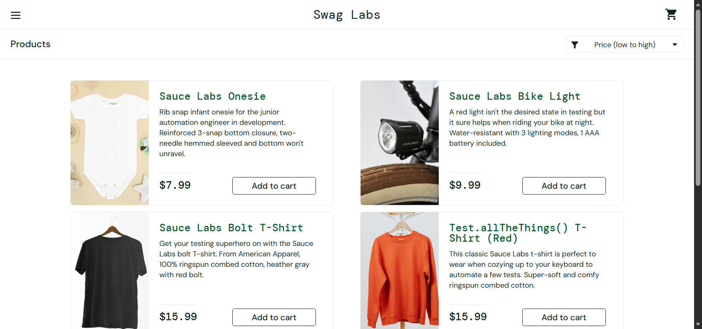
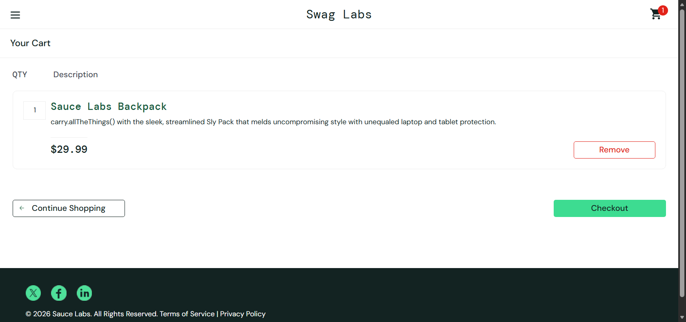
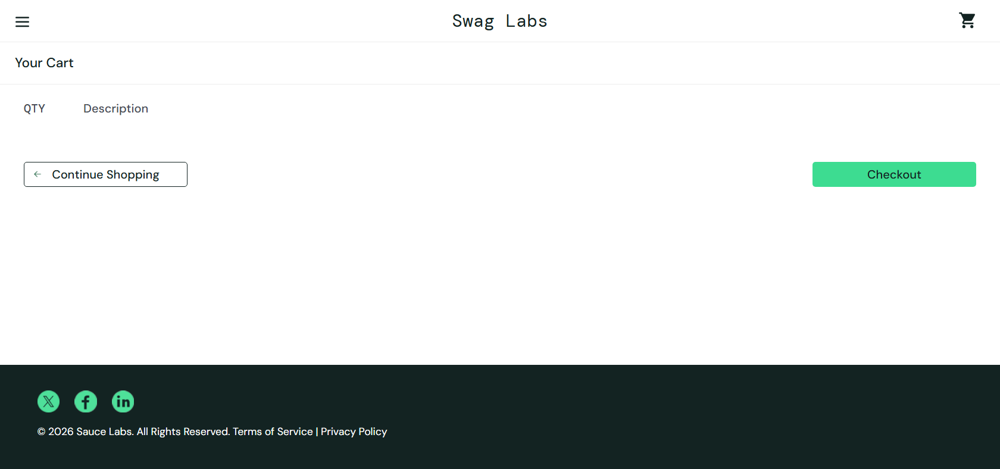
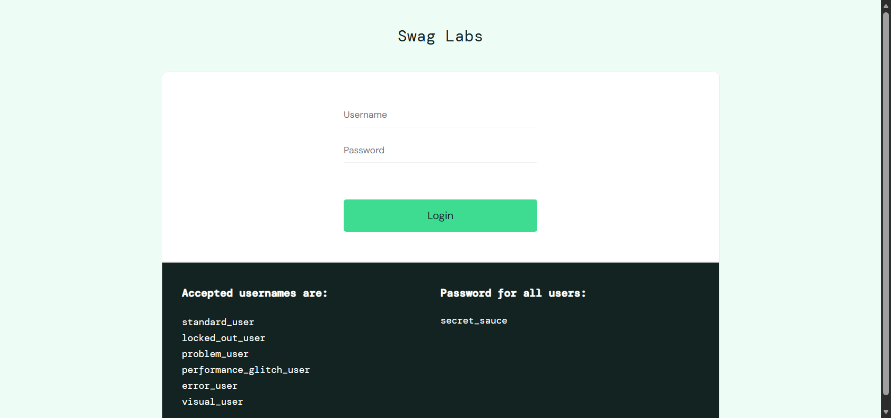

# BỘ KIỂM THỬ TỰ ĐỘNG BẰNG SELENIUM

Thực hành kiểm thử tự động với Selenium WebDriver (Python) trên website thương mại điện tử **Swag Labs**: [https://www.saucedemo.com/](https://www.saucedemo.com/).

---

## 📸 Kết Quả Thực Thi (Screenshots)

| TC01: Đăng nhập thành công | TC02: Báo lỗi tài khoản bị khóa |
| :---: | :---: |
|  |  |
| **TC03: Sắp xếp giá tăng dần** | **TC04: Thêm vào giỏ hàng** |
|  |  |
| **TC05: Xóa khỏi giỏ hàng** | **TC06: Đăng xuất an toàn** |
|  |  |

---

## 📋 Danh Sách Test Cases

| Mã TC | Tên Test Case | Mô tả & Kỳ vọng |
|---|---|---|
| **TC01** | Đăng nhập thành công | Nhập `standard_user` ➔ Chuyển hướng tới `/inventory.html`, hiện tiêu đề `Products`. |
| **TC02** | Đăng nhập thất bại | Nhập `locked_out_user` ➔ Bắt thông báo lỗi `Epic sadface: Sorry, this user has been locked out.`. |
| **TC03** | Sắp xếp sản phẩm | Chọn `Price (low to high)` ➔ Danh sách giá tự động sắp xếp tăng dần ($7.99 ➔ $49.99). |
| **TC04** | Thêm vào giỏ hàng | Click `Add to cart` ➔ Badge giỏ hàng hiển thị `1`, trang giỏ hàng có `Sauce Labs Backpack`. |
| **TC05** | Xóa khỏi giỏ hàng | Click `Remove` trong giỏ ➔ Giỏ hàng trống, badge giỏ hàng biến mất. |
| **TC06** | Đăng xuất hệ thống | Mở menu ➔ Click `Logout` ➔ Quay lại trang đăng nhập an toàn. |

---

## 🚀 Cách Chạy

* **Cách 1 (Nhanh nhất):** Nhấp đúp chuột vào file `run_tests.bat`.
* **Cách 2 (Dòng lệnh):**
  ```powershell
  python test_suite.py            # Chạy có giao diện
  python test_suite.py --headless # Chạy ngầm
  ```
